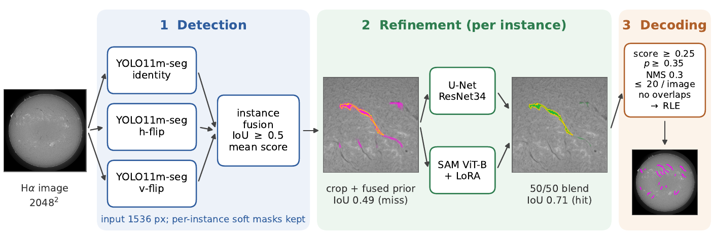

# Solar Filament Segmentation Challenge 2026

Team solution for the [Kaggle Solar Filament Segmentation Challenge 2026](https://www.kaggle.com/competitions/filament-segmentation-2026): instance segmentation of solar filaments in full-disk H-alpha images (MAGFiLO 1.0, 2048×2048).

**Final pipeline:**
- YOLO11m-seg detector at 1536 px;
- flip test-time augmentation with instance fusion;
- two full-resolution crop refiners, a U-Net and a SAM ViT-B + LoRA, whose outputs are averaged 50/50;
- calibrated post-processing.

It scores **0.474 PQ** on our date-grouped validation fold and **0.40 on the public leaderboard**.

## Team

Kaggle team: **vprg-cv-term**

- Tugce Keskin (Kaggle: tugcekskn)
- Dogus Can Korkmaz (Kaggle: doucankorkmaz)

## Results

| Model | Validation PQ | Public LB |
|---|---|---|
| **YOLO11m-seg 1536 + flip TTA + U-Net / SAM-LoRA refiner blend (final)** | **0.474** | **0.40** |
| same, prior-window U-Net refiner | 0.477 | 0.39 |
| YOLO11m-seg 1536 + flip TTA + mask thinning | 0.462 | 0.39 |
| same detector trained on all 707 images | – | 0.39 |
| Reference: public "LB 0.70" Mask R-CNN + refiner notebook, re-submitted | 0.416 | 0.34 |

- **Validation:** fold 0 of `data/splits/split_v1.json`, grouped by observation date. It has 142 images, 220 annotator views and 1545 filaments, scored with the organizer metric (per-view PQ, IoU > 0.5).
- **Baseline runs:** independent YOLO11s/m baseline runs on a separate 85/15 split used `src/train.py` and `src/predict.py`; their validation PQ ranges from 0.387 to 0.424.
- **Full write-up:** the report PDF is [`docs/report/report.pdf`](docs/report/report.pdf). Its LaTeX source is in [`docs/report/`](docs/report/), using the competition's ACM template (`main.tex`, `preamble.tex`, `main.bib`, `figures/`). The experiment log and the negative results are in [`reports/`](reports/).
- **Report numbers:** `scripts/report_stats.py` gives stage PQ with bootstrap CIs (`reports/report_stats.json`); `scripts/report_figures.py` draws the figures.

## Pipeline



In the example crop, the fused detector mask misses the annotated filament (IoU 0.49) and the blended refiners turn it into a hit (IoU 0.71). The same stages with the code that runs each one:

```
 *.jpeg test images
        |
        v
 [1] YOLO11m-seg @1536, soft masks cached (filseg.infer.predict_raw)
        |-- pass A: identity
        |-- pass B: horizontal flip
        '-- pass C: vertical flip
        v
 [2] instance fusion over the 3 passes, IoU 0.5            (filseg.ensemble.ensemble_caches)
        |
        +--------------------------+
        v                          v
 [3a] U-Net crop refiner     [3b] SAM ViT-B + LoRA crop refiner      (filseg.refine, filseg.sam_refine)
        |                          |
        +------------+-------------+
                     v
 [4] 50/50 soft-mask blend                                  (scripts/blend_caches.py)
                     v
 [5] post-process: conf 0.25, min_area 100, max_det 20, NMS 0.3, mask_thr 0.35
     (configs/calib.json), pixel-wise overlap resolution, RLE, format validation
                     v
              submission.csv
```

## Setup

```bash
python -m venv .venv && .venv/bin/pip install -r requirements.txt   # pinned versions, Python 3.12
.venv/bin/python -m pytest -q                                       # unit tests (36 pass; 2 need the data, 2 the external i079 weights)
```

**Hardware.** The pipeline expects a CUDA GPU; we used one RTX 4080 SUPER with 16 GB. The detector runs at 1536 px with batch 2 and the refiners run under fp16 autocast.

**No downloads needed.** Every file the pipeline loads is in this repository, including the base SAM ViT-B weights (`facebook/sam-vit-base`, Apache-2.0), committed as shards under 100 MB in `weights/sam_vit_base/`. Inference runs with `HF_HUB_OFFLINE=1`.

**Data layout.** The competition data is expected under `data/raw/MAGFiLO_1.0_Kaggle_2026/`:
- `train/train_images`
- `test/test_images`
- `train/MAGFiLO_1.0_Annotations_kaggle2026_train.json`

## Inference

Both routes below run the same pipeline from the committed weights, need no downloads, and write `submission.csv` in the repository root.

### Notebook

[`notebooks/inference.ipynb`](notebooks/inference.ipynb) runs the full pipeline stage by stage:

| Section | Stage | Output in `work/` |
|---|---|---|
| 0 | Setup: paths, `HF_HUB_OFFLINE=1`, list of test images | - |
| 1 | YOLO11m-seg at 1536 px, three passes (identity, horizontal flip, vertical flip), soft masks | `raw.pkl`, `raw_h.pkl`, `raw_v.pkl` |
| 2 | Instance fusion over the three passes (IoU >= 0.5) | `flip3.pkl` |
| 3 | U-Net and SAM ViT-B + LoRA crop refiners | `unet.pkl`, `sam.pkl` |
| 4 | 50/50 soft-mask blend | `blend.pkl` |
| 5 | Decoding with `configs/calib.json`, overlap resolution, RLE, format validation | `submission.csv` |
| 6 | Predicted contours on four test images | - |

- **What is committed:** the notebook is committed with the outputs of a full run on the 180 test images, so it can be read without running it.
- **Running it in Jupyter:** open the notebook and run all cells. It works when started from `notebooks/` or from the repository root.
- **Running it headless:**
  ```bash
  .venv/bin/python -m nbconvert --to notebook --execute --inplace notebooks/inference.ipynb
  ```
- **Other images:** set `FILSEG_IMAGES=/path/to/images` to use a different image directory. The default is `data/raw/MAGFiLO_1.0_Kaggle_2026/test/test_images`.

### Script

```bash
.venv/bin/python scripts/run_pipeline.py \
    --images data/raw/MAGFiLO_1.0_Kaggle_2026/test/test_images \
    --out submission.csv --workdir work/
```

- **Options:**
  - `--device`;
  - `--yolo`, `--unet`, `--sam`, `--calib` override the files in `weights/` and `configs/`;
  - `--imgsz 1536`, `--batch 2`, `--workers 8` (number of fusion processes);
  - `--force` recomputes cached stages.
- **Cached stages:** intermediate caches are kept in `--workdir` and reused on re-runs.

### Run time and reproducibility

- **Run time:** the full test set (180 images) takes about 13 minutes on one RTX 4080 SUPER.
- **Reproducibility:** both routes reproduce our public-0.40 submission. They give the same 1217 rows, and pooled PQ is 0.9995 when the original file is used as ground truth. The residual comes from fp16 numerical noise in the refiners.

## Model weights

| File | Role | Size |
|---|---|---|
| `weights/yolo11m_seg_1536.pt` | YOLO11m-seg detector, trained on the fold-0 training split at imgsz 1536 | 45 MB |
| `weights/unet_refiner.pt` | U-Net (ResNet34 encoder) crop refiner | 98 MB |
| `weights/sam_lora_refiner.pt` | SAM ViT-B LoRA adapters and trained prompt encoder / mask decoder | 19 MB |
| `weights/sam_vit_base/` | base SAM ViT-B weights (`facebook/sam-vit-base`, Apache-2.0) in 5 shards, plus `config.json` | 375 MB |
| `configs/calib.json` | post-processing parameters calibrated on the validation fold | < 1 KB |
| `configs/y11m_1536_train_args.yaml` | full Ultralytics training arguments of the detector | < 2 KB |

## Training

**Data preparation.** `scripts/prepare_data.py --all` builds two things:
- the YOLO dataset in `data/yolo/v1`, with one training sample per annotator view;
- the date-grouped split in `data/splits/split_v1.json`.

| Model | Command |
|---|---|
| Detector | `python scripts/train.py --model yolo11m-seg.pt --imgsz 1536 --name y11m_1536` (80 epochs, AdamW, lr0 1e-3, batch 2, seed 0) |
| Training proposals for the refiners | `python scripts/predict.py --weights runs/y11m_1536/weights/best.pt --subset train --imgsz 1536 --soft --out-cache artifacts/refiner/train_raw.pkl` |
| U-Net refiner | `python scripts/train_refiner.py --out artifacts/refiner/refiner.pt` (25 epochs, batch 32, AdamW 3e-4, cosine; BCE + Dice) |
| SAM-LoRA refiner | `python scripts/train_refiner.py --arch sam --epochs 3 --batch 2 --lr 1e-4 --out artifacts/refiner_sam/sam_refiner.pt` (LoRA rank 16, about 50 min per epoch) |
| Post-processing calibration | `python scripts/calibrate.py` on the validation caches |

**Validation helpers:**
- `scripts/full_eval.sh <run> <imgsz>` runs flip TTA, fusion, the refiner and PQ for a trained run.
- `scripts/eval_params.py` scores a cache at given decoding parameters.
- `src/filseg/metrics.py` holds `fast_evaluate`, our implementation of the organizer metric. It is unit-tested against the official self-evaluation notebook.

## Repository structure

```
src/filseg/        final pipeline library: data/GT handling, inference, fusion, refiners, post-processing, metric, RLE
scripts/           training, inference, calibration, report numbers and the experiments in the report (G0-G2 audits, rescorer, dataset variants)
configs/           calibrated post-processing parameters and detector training arguments
weights/           final model weights
notebooks/         01_eda.ipynb (exploratory analysis), inference.ipynb (end-to-end pipeline)
tests/             unit tests (metric, RLE, post-processing, fusion)
docs/report/       report (ACM LaTeX template, figures, bibliography)
docs/              data analysis and error analysis notes, figures, project guide
reports/           geometry audit (G0), path completion (G1) and Skeleton-Recall (G2) experiment reports
src/*.py           first baseline (YOLO11s/m, separate split; data root from MAGFILO_ROOT)
```

## What did not help

Each item below was measured on the same validation fold. Details are in the report and in `reports/`.

**Detector changes, all within seed noise (±0.005):**
- larger input (1792 px);
- flat-field / CLAHE input;
- multi-model and multi-seed ensembles;
- multi-scale TTA;
- copy-paste, loss weights, consensus labels;
- a two-class detector;
- positive-unlabelled training.

**Decoding and post-processing:**
- A second-stage candidate rescorer (gradient boosting, 5-fold out-of-fold) did not help: PQ 0.469 vs 0.474.
- Per-instrument thresholds did not help either.

**Geometry fixes:**
- Darkness-guided path completion of fragmented filaments made PQ worse in every setting, by −0.0003 to −0.09.
- A Skeleton-Recall loss in the refiner gained at most +0.003, inside seed noise.

## Licences

- Code in this repository: see `LICENSE`.
- Dependencies keep their own licences; Ultralytics (YOLO) is AGPL-3.0.
- The base SAM weights (`facebook/sam-vit-base`), redistributed in `weights/sam_vit_base/`, are Apache-2.0.
- No external annotations or external training data were used.
